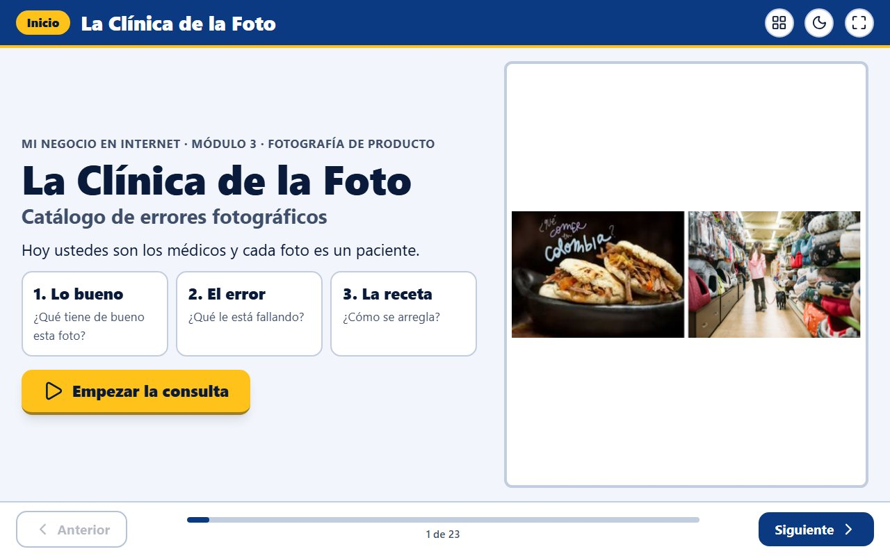
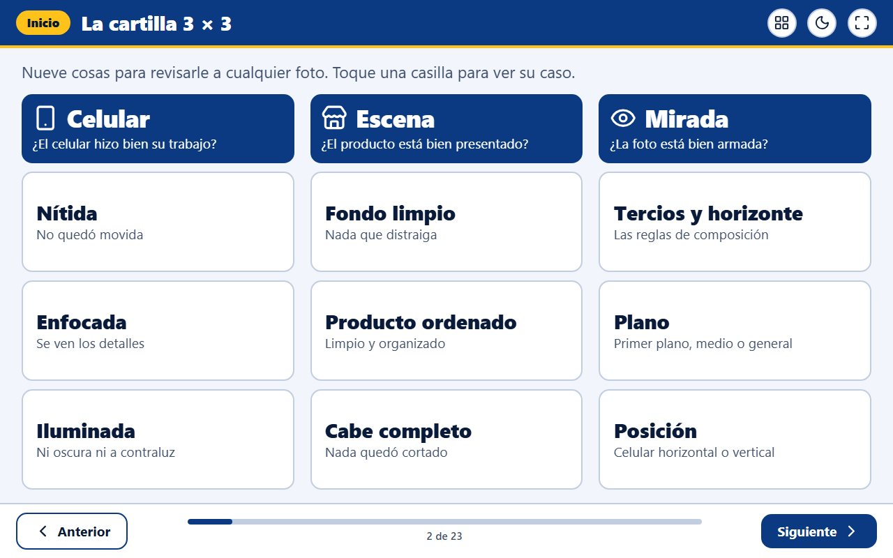
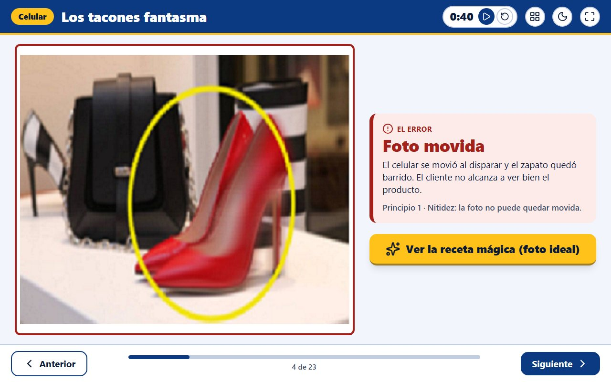
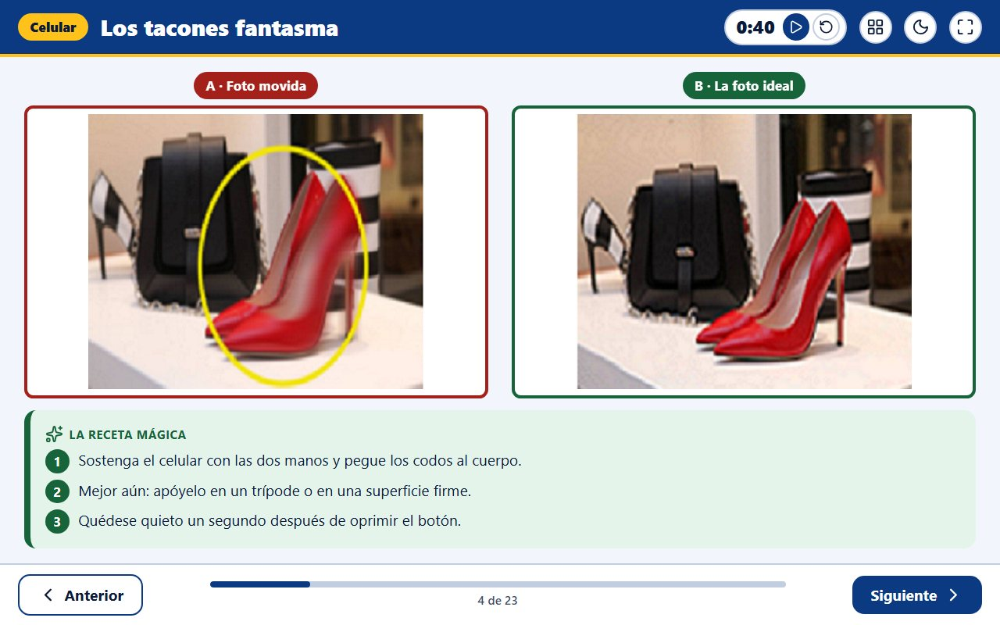
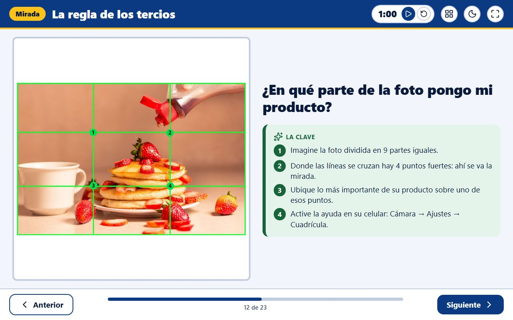
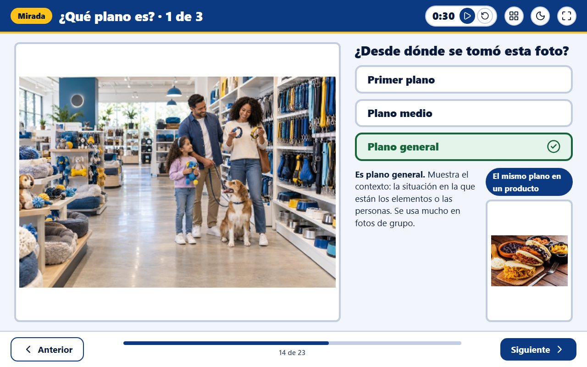

<picture>
  <source media="(prefers-color-scheme: dark)" srcset="assets/mys-logo-blanco.png">
  
</picture>

# 🩺 La Clínica de la Foto

### Un taller proyectable donde el grupo diagnostica fotos de producto: qué tienen de bueno, cuál es el error y cómo se arregla

**MyS SinergiaaS**: Consultoría y Tecnología
*Automatiza. Escala. Vende.*

`En producción` · `Sin registro` · `Sin instalación` · `Letra grande` · `Hecho para proyectar` · `20 minutos de clase`

---

## El problema

Enseñar fotografía de producto con diapositivas llenas de teoría no funciona:
los emprendedores, muchos de ellos adultos mayores, escuchan las reglas y al
día siguiente publican la misma foto oscura, movida y con la escoba al fondo.
Las reglas solo se aprenden cuando se ven fallar en una foto concreta.

## La solución

**El grupo hace de médico y cada foto es un paciente.** El docente proyecta el
taller y, caso por caso, la clase responde tres preguntas: *¿qué tiene de
bueno?*, *¿cuál es el error?* y *¿cuál es la receta?*

### Una cartilla de nueve casillas
Todo el tema cabe en una cartilla de 3 × 3: lo que debe hacer el **celular**
(nítida, enfocada, iluminada), cómo debe estar la **escena** (fondo limpio,
producto ordenado, cabe completo) y cómo se arma la **mirada** (tercios y
horizonte, plano y posición). Cada casilla lleva a su caso.

### Primero el error, después la receta
Cada caso muestra la foto con el problema señalado. El grupo opina y, cuando el
docente lo decide, aparece la comparación con la foto ideal y los pasos para
lograrla.

### Las reglas de composición, dibujadas sobre la foto
La regla de los tercios y la línea del horizonte se ven con la cuadrícula
encima de una foto real, y los planos se practican adivinando desde dónde se
tomó cada imagen.

---

## Lo que lo hace distinto

| | |
|---|---|
| 🧓 **Pensado para adultos mayores** | Letra grande que crece con la pantalla, alto contraste y un solo mensaje por pantalla. |
| ⏱️ **Cabe en 20 minutos** | Cada pantalla trae su temporizador y el índice permite saltar a cualquier caso. |
| 🎯 **Enseña con el error** | Primero se ve la foto que falla; la regla llega como solución, no como teoría. |
| 🖥️ **Hecho para el proyector** | Pantalla completa, teclado para avanzar y tema claro u oscuro según la sala. |
| ✅ **Cierra con práctica real** | Lista de revisión antes de disparar, un reto con el propio celular y una guía para analizar tiendas reales. |
| 🏷️ **Adaptable** | La misma dinámica con otras fotos, otros productos u otra marca. |

---

## Para quién

- **Docentes y programas de emprendimiento** que enseñan ventas por internet.
- **Cámaras de comercio, fundaciones, cajas de compensación y alcaldías** con
  programas de inclusión digital.
- **Emprendedores** que quieren revisar sus fotos antes de publicarlas.

---

## Probarlo

No se instala nada. No hay registro. Se abre el enlace y se empieza:

### **→ [clinica-de-la-foto.vercel.app](https://clinica-de-la-foto.vercel.app)**

---

## Modalidades de implementación

| Modalidad | Para quién |
|---|---|
| **Uso directo** | La herramienta pública, tal como está, abierta para cualquier aula. |
| **Marca blanca** | Su identidad visual, su dominio y sus propios productos de ejemplo. |
| **Implementación a la medida** | Otros temas de clase enseñados con la misma dinámica. |
| **Taller facilitado** | La experiencia completa, dirigida en su institución por MyS SinergiaaS. |

Para cotizar cualquiera de ellas: **[hablemos por WhatsApp](https://wa.me/573148788974)**.

---

## ⚖️ Aviso legal y comercial

> **Este repositorio es una exhibición de portafolio.**
>
> Publica el **resultado** del producto (qué resuelve, cómo se usa y qué
> entrega) con fines comerciales y de demostración de capacidad técnica.
> **No contiene el código fuente de la aplicación.**
>
> El código fuente, el contenido pedagógico y el diseño de la dinámica son
> **propiedad intelectual exclusiva de MyS SinergiaaS**. No se distribuyen,
> licencian ni publican bajo ninguna licencia de código abierto.
>
> Las fotos de ejemplo que aparecen en las capturas son material didáctico del
> curso y pertenecen a sus respectivos titulares; se muestran solo con fines de
> enseñanza.
>
> El acceso público se ofrece para evaluación, demostración y uso en el aula.
> Su uso comercial, reventa, ingeniería inversa o incorporación a un producto
> de terceros requiere acuerdo escrito previo.
>
> © 2026 MyS SinergiaaS. Todos los derechos reservados.

---

## Hablemos

**Mac Eduardo Sáenz Martínez**
Dirección de Proyectos · Arquitectura de Soluciones · Transformación Digital
Valencia, Córdoba (Colombia)

